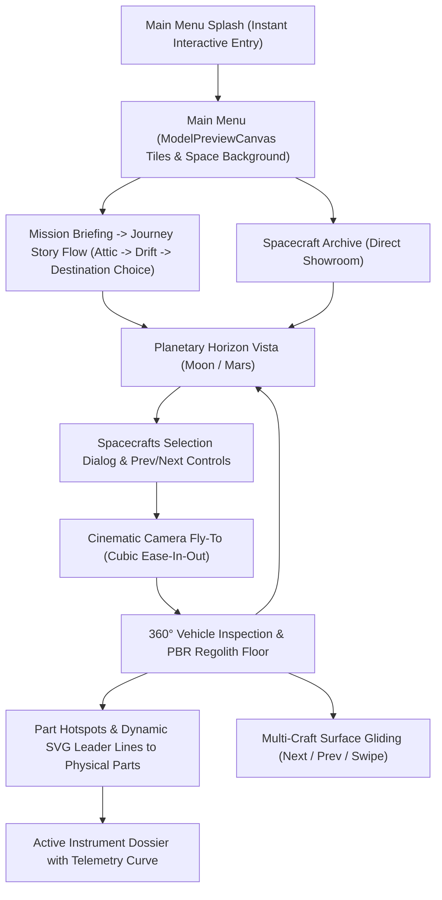

# "Abandoned But Not Forgotten" — Project Documentation & Architectural Reference

**NASA Space Apps Hackathon Web Application**  
*An interactive narrative and 3D exploration experience documenting historic spacecraft abandoned across the solar system.*

---

## 1. Executive Summary & Tech Stack

"Abandoned But Not Forgotten" allows users to experience ground-level explorations of human spacecraft resting in silence across the Moon and Mars. Users transition seamlessly from a story-driven prologue into panoramic planetary horizons, inspect spacecraft in 360° detail, and examine technical instruments via NASA JPL telemetry HUD overlays.

| Category | Technology | Purpose |
| :--- | :--- | :--- |
| **Framework & UI** | React 18, Vite 6 | Component lifecycle, route/view lazy code splitting (`React.lazy`), fast HMR bundling |
| **3D Engine** | Three.js (`three@0.187.0`) | Shared Three.js preview canvases (`ModelPreviewCanvas`), menu background crafts, and unified planetary surface environments with PBR materials |
| **Asset Caching & Decoders** | Singleton `GLTFLoader`, `DRACOLoader` (`/draco/`), `MeshoptDecoder` | Deduplicated fetches, streaming progress, bounded LRU buffer cache, and local WebAssembly Draco decoding |
| **Audio Engine** | Web Audio API Synthesizer | Procedural thrusters, mechanical servos, thin Martian wind, Lunar vacuum hum |
| **Visual Language** | Vanilla CSS + Lucide React | Unified NMS template styling: `NMSGeoSans` headings, `NMSFuturaProBook` UI/body (`Tajawal` Arabic fallback), `rgba(0, 0, 0, 0.9)` panels with `1px solid #ffffff` borders, `10px` card radii, and `5px` monochrome buttons |

---

## 2. Complete Architecture & Feature Catalog



---

## 3. Detailed Component Breakdown

### 3.1 Instant Splash Entry, Code Splitting & Lazy Preloading
- **Location**: `src/App.jsx`, `src/utils/modelCache.js`, `src/styles/menu.css`
- **Features**:
  - No blocking full-screen preloader on initial startup: the title splash (`ABANDONED BUT NOT FORGOTTEN`) renders immediately alongside lightweight `CosmicBackground` animations.
  - Non-menu views (`StoryGame`, `PlanetaryShowroom`), dialogs (`SettingsModal`, `CreditsModal`, `MissionBriefingDialog`), and `Three.js` vendor chunks are code-split via `React.lazy` and `vite.config.js` `manualChunks`.
  - Background menu assets warm opportunistically via `prefetchGLB` after splash entry without blocking UI interaction.
  - Starting the story preloads only the `StoryGame` chunk and initial Scene 1/2 images (with inline error/retry handling), deferring Moon/Mars showroom terrains until the user chooses a destination.

### 3.2 Main Menu, Shared 3D Previews & Space Background
- **Location**: `src/components/MainMenu.jsx`, `src/components/ModelPreviewCanvas.jsx`, `src/components/CosmicBackground.jsx`, `src/components/StarfieldCanvas.jsx`, `src/components/FloatingCraftsCanvas.jsx`
- **Features**:
  - **Smooth Splash-to-Menu Entry**: `.nms-splash` and `.nms-horizon-glow` transition exclusively via compositor properties (`opacity`, `transform`), and `<ModelPreviewCanvas>` menu tile WebGL contexts mount staggered after the `nmsRise` entrance settles so keypress/tap transition stays jank-free.
  - `ModelPreviewCanvas`: Shared Three.js preview component replacing `@google/model-viewer`, using `modelCache.js`, `ResizeObserver`, `IntersectionObserver`, `document.visibilitychange`, `paused` prop control, `prefers-reduced-motion` support, and WebGL context-loss recovery.
  - `CosmicBackground`: 2D multi-layer `StarfieldCanvas` (static frame under `prefers-reduced-motion`, DPR & density scaled by active Graphics Quality preset) paired with `FloatingCraftsCanvas` (staggered lazy loading of optimized `*-opt.glb` models via shared cache). Remains animated behind `CreditsModal` while pausing hidden menu tile canvases (`menuTilesPaused`), and pauses cleanly on opaque/blocking dialogs (`SettingsModal`, `SourcesModal`, launch screen).
  - `SettingsModal` (`src/constants/settings.js` defaults + audio, **Graphics Quality** (`Quality` default, `Balanced`, `Performance`), and language persistence in `localStorage`), `CreditsModal` (rolling credits dialog), and lazy-loaded `SourcesModal` (linked from Main Menu `Sources` button).

### 3.3 Narrative Journey & Educational Storytelling Layer
- **Location**: `src/components/StoryGame.jsx`, `src/data/craftStories.js`, `src/components/StatusBadge.jsx`, `src/components/ShowroomStoryPanel.jsx`, `src/components/MoreEquipmentModal.jsx`, `src/components/SourcesModal.jsx`
- **Features**:
  - **Storybook Framing (`StoryGame.jsx`)**: Each prologue and choice stage displays concise grandfather logbook opening notes (`.story-logbook-note`) paired with preloaded cutscenes (`book` -> `drift` -> `choice`).
  - **Bilingual Story Data Layer (`src/data/craftStories.js`)**: Stores bilingual `{ en, ar }` records (`getCraftStory`, `getArchiveEquipment`, `getAllCraftSources`, `useActiveLanguage`) synced with `SettingsModal` language state (`gameSettingsChange`). Strictly enforces verified NASA claims (surface craft are *remaining equipment* / *mission relics* / *halted spacecraft*; ancient liquid water is distinguished from confirmed life; unreviewed details — including **Ingenuity** and **Viking 1** — are flagged `status: 'unverified'` and display `"Unconfirmed in the sources we reviewed"`).
  - **Extended Dossier & Status HUD**: Active Dossier cards feature reusable `<StatusBadge />` (`HALTED`, `PASSIVE & STILL USEFUL`, `ACTIVE AS OF LAST UPDATE`, `UNVERIFIED`) + `"VERIFIED: <date>"` chips, matching status dots on bottom craft selector pills, collapsible story sections (`THE QUESTION`, `THE EXPERIMENT`, `THE DISCOVERY`, `THE END`, `VERIFY`), a non-punitive Knowledge Check (`quiz`), and `"DO WE APPROACH THE INSTRUMENT?"` referencing NASA's 2011 Lunar Heritage technical recommendations (`playLock`/`playUnlock`/`playServo` cues).
  - **Lazy-Loaded Archive & Sources Modals**: `"MORE EQUIPMENT"` opens `MoreEquipmentModal.jsx` with region filters and 2D archive cards (Moon ALSEP/Retroreflectors, Mars Pathfinder/Sojourner/Spirit/Phoenix/InSight, plus Deep Space contrast timeline for Pioneer 10 vs Voyager 1/2 & New Horizons); `"VIEW ALL SOURCES"` opens `SourcesModal.jsx`.

---

## 4. Planetary Showroom & 3D Environments

### 4.1 The Moon Landscape & Earthrise
- **Terrain**: `moon_surface-opt.glb` (7.37 MiB welded single-mesh scene-Draco + WebP q90 derivative of `models/moon_surface.glb`, 50.25 MiB).
  - Elevation offset calibrated to `y = 239.28`, placing the central crater floor flush at `y = 0.000`.
  - Camera `far` increased to `8000` to preserve the complete 10-kilometer lunar crater and mountain rim vistas.
  - Zero flat gray obstruction: artificial planar ground skirt removed, uncovering the continuous 3D lunar soil, crater bowls, and natural mountain horizons without tile seam cracks.
  - Linear vacuum horizon blend: `THREE.Fog(0x020409, 3500, 7500)` ensures 100% vacuum clarity across the entire exploration crater (0–3500m) while softly dissolving distant geometry into the starfield.
- **Starfield**: 3,000 randomized Three.js point stars in deep vacuum.
- **Coherent Lighting & PBR Calibration**:
  - **Key Solar Radiance**: Directional sun (`#fffaea`, intensity 2.45) with `±24m` shadow bounds, `shadow.normalBias = 0.025`, `shadow.radius = 2`, and `THREE.PCFShadowMap` for crisp, realistic shadows without acne.
  - **Earthshine Directional Fill**: Cool blue directional light (`#4080bf`, intensity 0.6) originating from Earth's coordinates `[-65, 38, -120]` towards the rover.
  - **Hemisphere Ambient & IBL**: Dual-tone balance (`#587296` deep space sky / `#242428` regolith bounce, intensity 0.42) and attenuated terrain `envMapIntensity = 0.14` preserving high Apollo crater contrast while revealing rover undercarriage/foil details.
- **3D Earthrise**:
  - Utilizes `realistic_earth-opt.glb` (1.04 MiB derivative of `models/realistic_earth.glb`, 39.16 MiB) positioned at `[-65, 38, -120]` in the lunar sky.
  - Natural celestial appearance: 2D planar ring geometry removed, letting the spherical Earth rotate naturally against the starfield.
  - Frame-rate independent orbital rotation using `THREE.Timer` (`earthMesh.rotation.y += 0.036 * dt`, paused cleanly under `prefers-reduced-motion` or modal overlays).
- **Spacecraft on the Moon**:
  - **Apollo Lunar Roving Vehicle (LRV)** (`lunar_rover-opt.glb`, 2.65 MiB derivative of `models/mondfahrzeug_lunar_rover.glb`, 50.56 MiB):
    - Position: `[0, 0, 0]`, rotation: `[0, -0.4, 0]`.
    - Camera: Focus `[2.8, 1.25, 3.4]`, LookAt `[0, 0.65, 0]`.
    - Dedicated PBR Material Calibration:
      - Woven Wire Wheels: `metalness: 0.55`, `roughness: 0.38` (metallic wire sheen).
      - High-Gain Antenna Dish: `metalness: 0.65`, `roughness: 0.32` (gold mesh alloy).
      - TV Camera Lens: `metalness: 0.30`, `roughness: 0.12` (optical glass).
      - Astronaut Seats: `metalness: 0.28`, `roughness: 0.48` (aluminum tubing).
      - T-Handle Console: `metalness: 0.22`, `roughness: 0.42`.
      - Damping & Suspension: `metalness: 0.50`, `roughness: 0.35`.

### 4.2 Mars Landscape (`mud_of_mars-opt.glb`) & Fleet Scattering
- **Terrain**: Real Martian terrain `mud_of_mars-opt.glb` (537.26 KiB derivative of `models/mud_of_mars.glb`, 19.52 MiB).
  - Expanded scale: Scaled horizontally to `140.0` (spanning 280 meters across) and vertically to `35.0` (elevation offset `y = 0.319`), creating expansive rolling red dunes and regolith with genuine 3D relief.
  - High-frequency texture density: 6x repeatable UV wrapping on diffuse and normal maps preserving micro-fissures, pebbles, and fine dust textures without blur or stretching.
  - Seamless non-square circular perimeter taper: Vertices beyond radius `0.60` (84m from center) smoothly taper via S-curve down to the circular ground skirt (`y = -0.21`), completely eliminating square edges and 90-degree corners.
  - Boundless 600m circular horizon skirt (`#762f1a`) and matching atmospheric dust fog (`#240d08`, linear `35m` to `175m`), ensuring the horizon dissolves into an endless 360° Martian desert.
  - Warm golden directional sun (`#ffc58e`, intensity 2.5) with wide frustum shadow coverage spanning all separated spacecraft (`normalBias: 0.02`), and atmospheric hemisphere ambient bounce (`#ffbe85` dusty amber / `#6e311f` iron oxide red, intensity 0.85).
- **Separated Martian Fleet**:
  - **MER-B Opportunity Rover** (`mer_rover-opt.glb`, 715.61 KiB derivative of `models/24883_MER_static.glb`, 11.36 MiB):
    - Central foreground at `[0, 0, 0]`, rotation `[0, 0.35, 0]`.
    - Camera: Focus `[2.5, 1.25, 2.9]`, LookAt `[0, 0.65, 0]`.
    - Calibrated PBR response (`metalness: 0.35`, `roughness: 0.45`) preventing dark specular clipping.
  - **Ingenuity Mars Helicopter** (`ingenuity-opt.glb`, 344.68 KiB derivative of `models/Ingenuity Mars Helicopter.glb`, 1.93 MiB):
    - Separated to the left on a flight ridge at `[-14.0, 0.02, -7.0]` (~15.7m from Opportunity).
    - Camera: Focus `[-12.8, 1.03, -5.6]`, LookAt `[-14.0, 0.48, -7.0]`.
    - Calibrated composite carbon and aluminum response (`metalness: 0.35`, `roughness: 0.40`).
  - **Viking 1 Lander** (`viking_lander-opt.glb`, 243.48 KiB derivative of `models/Viking Lander.glb`, 1.76 MiB):
    - Separated to the right on a scientific plain at `[16.0, -0.08, -8.0]` (~17.9m from Opportunity, ~30m from Ingenuity).
    - Camera: Focus `[17.6, 1.46, -6.4]`, LookAt `[16.0, 0.66, -8.0]`.
    - Custom PBR material pass (`roughness: 0.58`, `metalness: 0.25`, diffuse tone) eliminating specular whiteout.

---

## 5. 3D HUD Pointers & Dynamic Telemetry Leader Lines

Every vehicle part has synchronized SVG leader lines projecting from 3D world space onto the 2D screen.

### 5.1 Calibrated Part Hotspots Table

| Spacecraft | Hotspot ID | Part Name | Calibrated World Position | Pointer Offset |
| :--- | :--- | :--- | :--- | :--- |
| **Lunar Rover** | `lrv-tv` | Color TV Camera | `[0.68, 1.15, 0.40]` | `{ x: 80, y: -50 }` |
| | `lrv-hga` | High-Gain Umbrella Dish | `[0.99, 1.55, 0.14]` | `{ x: 85, y: -65 }` |
| | `lrv-wheel` | Woven Wire Wheels | `[0.29, 0.38, 0.75]` | `{ x: -85, y: -35 }` |
| | `lrv-battery`| 36V Dual Ag-Zn Battery | `[0.12, 0.75, 0.35]` | `{ x: 85, y: 40 }` |
| **Opportunity** | `oppy-pancam` | Pancam/Navcam Mast | `[-0.04, 1.55, 0.34]` | `{ x: 80, y: -50 }` |
| | `oppy-solar` | Solar Array Wings | `[0.92, 1.10, -0.29]` | `{ x: 85, y: -25 }` |
| | `oppy-arm` | 5-Joint Arm & RAT | `[-0.04, 0.50, 0.75]` | `{ x: -85, y: 35 }` |
| | `oppy-wheels`| Rocker-Bogie Mobility | `[0.98, 0.35, -0.11]` | `{ x: 85, y: 45 }` |
| **Ingenuity** | `ing-solar` | Top Solar Array | `[-14.00, 0.80, -7.00]` | `{ x: 85, y: -55 }` |
| | `ing-rotor-upper` | Upper Rotor Blade | `[-13.75, 0.66, -6.85]` | `{ x: -85, y: -35 }` |
| | `ing-rotor-lower` | Lower Rotor Blade | `[-14.25, 0.54, -7.15]` | `{ x: 85, y: -20 }` |
| | `ing-camera` | Nav Eye & Horizon Cam | `[-13.95, 0.34, -6.90]` | `{ x: -85, y: 40 }` |
| **Viking 1** | `viking-hga` | High-Gain S-Band Dish | `[16.05, 1.27, -8.25]` | `{ x: 85, y: -55 }` |
| | `viking-camera`| Surface Facsimile Cameras | `[15.95, 1.17, -7.85]` | `{ x: -85, y: -45 }` |
| | `viking-arm` | Soil Sampler Boom & Scoop| `[16.55, 0.37, -7.65]` | `{ x: 85, y: 35 }` |
| | `viking-rtg` | SNAP-19 RTG Power | `[15.55, 0.67, -8.15]` | `{ x: -85, y: 30 }` |

### 5.2 Technical Drawing Leader Line Mechanics
- **Anchor**: Sits directly on the 3D coordinate with a glowing dot and pulsing radar ping (`transform-box: fill-box; transform-origin: center;`).
- **Elbow Leader**: An SVG path segment connects `(partX, partY)` to an elbow point, then runs horizontally into the telemetry badge.
- **Active Dossier Telemetry Curve**: When a part is selected, a quadratic bezier curve with an animated dash (`dossierDash`) dynamically routes from the physical part into the dossier card header.
- **Frustum Test**: Guarded with `toPoint.dot(camDir) > 0.05` to guarantee zero inverted or back-facing artifacts.

---

## 6. Wide Horizon Vista, Spacecrafts Briefing & Render Loop Management

- **Wide Vista Perspective**:
  - Moon Vista: `[0, 1.8, 14.5]` looking at `[0, 0.9, 0]`.
  - Mars Vista: `[0, 2.0, 12.0]` looking at `[0, 0.75, -1.0]`.
- **Mission Control Typewriter Briefing & Gliding Navigation**:
  - Entering any showroom (or clicking `SPACECRAFTS` in the HUD) displays the live wide planetary horizon while playing the bottom `MISSION CONTROL` `.ui-dialogue` typewriter briefing (`MissionBriefingDialog`) without freezing background rendering.
  - Finishing or skipping the dialog smoothly glides the camera (`focusDuration = 1.6s`) directly into 360° orbit inspection of index `0` (Lunar Rover on Moon / All, **MER Opportunity** on Mars).
  - Next/Prev buttons, bottom pills, keyboard arrow keys, and mobile swipe switch directly across all vehicles on the surface.
- **Lifecycle, Render-Loop & Reliability Controls**:
  - **Parallel Loading & Cancellation**: Uses `Promise.all` with `AbortController` + load token tracking via `modelCache.js` to prevent duplicate downloads or stale destination switches.
  - **Demand Rendering & Pause**: Stops `requestAnimationFrame` immediately when `document.hidden`, while `showStoryModal` is open, and when idle on Mars (or `prefers-reduced-motion` on Moon); wakes cleanly on orbit interaction, resize, camera fly-to, or vehicle selection.
  - **GPU Disposal & Context Recovery**: Calls `clearAndDisposeGroup` across switches/unmounts, resolves effective Three.js pixel ratio, shadows, star density, and antialiasing from the user's selected **Graphics Quality** preset (`Quality`, `Balanced`, or `Performance`) via `resolveGraphicsProfile` (without silently overriding user choice), handles `webglcontextlost`/`webglcontextrestored`, and renders inline error/retry + WebGL fallback UI if needed.

---

## 7. Procedural Web Audio Engine

- **Location**: `src/audio/surfaceAudio.js`
- **Zero MP3 Assets**: All sounds are synthesized in real time using the browser's Web Audio API.
- **Cues & Synthesizers**:
  - `playThruster`: Cold-gas and hydrazine bursts using white noise buffer through resonant bandpass filters with exponential gain envelope decay.
  - `playServo`: Dual-oscillator pitch-gliding frequency sweeps simulating camera gimbal servos.
  - `playLock` / `playUnlock`: Two-tone frequency pings for part inspection lock/release.
  - `startSurfaceAmbience`:
    - Mars: Dual pink-noise wind generators through low-pass filters with subtle frequency modulation.
    - Moon: Deep 58Hz vacuum electrical hum with subtle radio carrier frequency shifts.
  - **Auto-Unlock**: Automatically unlocks Web Audio context on the first user interaction (`pointerdown`, `touchstart`, `keydown`).

---

## 8. 3D Asset Pipeline & Repository Structure

### 8.1 Offline Optimization Pipeline (`scripts/optimize-models.mjs`)
- Run via `npm run optimize:models` (`@gltf-transform/cli`).
- All raw source `.glb` models are archived intact inside root `models/` (never deleted or overwritten).
- Runtime derivatives (`*-opt.glb`) in `public/models/` apply Draco mesh compression (`KHR_draco_mesh_compression`) and WebP textures (`EXT_texture_webp`) while preserving origins, UV tiling, and named PBR materials (`'Chassis'`, `'Wheels'`, `'Antenne'`, etc.).
- Total size of the 10 active runtime models dropped from **203.24 MiB** (`213.11 MB`) in `models/` to **14.88 MiB** (`15.61 MB`) in `public/models/`.
- Decoders are served locally from `public/draco/` (`draco_decoder.js`, `draco_decoder.wasm`, `draco_wasm_wrapper.js`) with Web Worker concurrency capped cleanly.

### 8.2 File Structure & Asset Inventory

```
NASA hackton/
├── models/                        # Untouched original raw GLB sources & legacy provenance backups
├── public/
│   ├── assets/story/              # Story scene paintings & character illustrations
│   ├── draco/                     # Local Three.js glTF Draco WASM/JS decoders
│   └── models/                    # 10 Draco + WebP optimized runtime *-opt.glb files (13.80 MiB total)
│       ├── lunar_rover-opt.glb    # Apollo Lunar Roving Vehicle (2.65 MiB)
│       ├── mer_rover-opt.glb      # Mars Exploration Rover Opportunity (715.61 KiB)
│       ├── ingenuity-opt.glb      # Mars Helicopter Ingenuity (344.68 KiB)
│       ├── viking_lander-opt.glb  # Viking 1 Lander (243.48 KiB)
│       ├── astronaut_helmet-opt.glb # Menu Archive tile model (419.41 KiB)
│       ├── moon_surface-opt.glb   # Welded Moon crater terrain (7.37 MiB)
│       ├── mud_of_mars-opt.glb    # Martian mud & rock regolith terrain (537.26 KiB)
│       ├── realistic_earth-opt.glb # 3D Earth backdrop globe (1.04 MiB)
│       ├── moon-opt.glb           # Interactive Moon globe for Choice screen (465.34 KiB)
│       └── mars-opt.glb           # Interactive Mars globe for Choice screen (69.75 KiB)
├── scripts/
│   └── optimize-models.mjs        # Reproducible original -> *-opt.glb transform script
├── src/
│   ├── audio/
│   │   └── surfaceAudio.js        # Web Audio API procedural synthesis engine
│   ├── components/
│   │   ├── CosmicBackground.jsx   # Starfield + floating crafts host with pause forwarding
│   │   ├── CreditsModal.jsx       # Lazy-loaded rolling credits modal
│   │   ├── FloatingCraftsCanvas.jsx # Staggered lazy 3D menu craft flybys (paused when covered)
│   │   ├── MainMenu.jsx           # Instant title splash, staggered ModelPreviewCanvas tiles & side list
│   │   ├── MissionBriefingDialog.jsx # Lazy-loaded typewriter briefing dialog (+ secondary actions)
│   │   ├── ModelPreviewCanvas.jsx # Shared Three.js preview component (replaces model-viewer)
│   │   ├── MoreEquipmentModal.jsx # Lazy-loaded 2D Moon/Mars/Deep Space equipment archive modal
│   │   ├── PlanetaryShowroom.jsx  # Unified Three.js Moon/Mars showroom, dossier & briefing flow
│   │   ├── SettingsModal.jsx      # Lazy-loaded audio, graphics quality & language dialog
│   │   ├── ShowroomStoryPanel.jsx # Collapsible story sections, quiz & heritage decision HUD
│   │   ├── SourcesModal.jsx       # Lazy-loaded verification & primary source index modal
│   │   ├── StarfieldCanvas.jsx    # Preset-scaled, reduced-motion & pause-aware 2D starfield
│   │   ├── StatusBadge.jsx        # Reusable HUD craft status badge + VERIFIED date chip
│   │   └── StoryGame.jsx          # Lazy-loaded narrative prologue, logbook notes & destination flow
│   ├── constants/
│   │   └── settings.js            # Default settings, language list & Graphics Quality presets
│   ├── data/
│   │   └── craftStories.js        # Bilingual {en, ar} educational stories, quizzes & verified sources
│   ├── styles/
│   │   ├── menu.css               # Main menu, shared HUD tokens, splash & modal styles
│   │   ├── story.css              # Narrative cutscenes, logbook notes, choice cards & reduced-motion
│   │   └── spacecraft.css         # Showroom viewport, dossier, quiz, status badges & archive UI
│   ├── utils/
│   │   └── modelCache.js          # Singleton GLTFLoader/DRACOLoader, fetch dedupe & LRU buffer cache
│   ├── App.jsx                    # Top-level lazy route/modal orchestration & preloading
│   └── main.jsx                   # React root mount
├── index.html
├── package.json
└── vite.config.js                 # Vite 6 config with vendor manualChunks splitting
```

---

## 9. Verification & Operational Status

- **Optimization Pipeline**: `npm run optimize:models` verified against untouched originals in `models/` generating all 10 `public/models/*-opt.glb` runtime assets cleanly.
- **Production Build & Browser Verification**: Verify with `npm run build` (`vite build`) and live headless browser profiling against `vite preview` before shipping changes.

---

## 10. Unified UI, Multi-Language & Audio Architecture (Update)

### 10.1 Unified Design Template
- **Dialogue Boxes**: Standardized to rounded black cards (`rgba(0, 0, 0, 0.95)`, `1px solid #ffffff`, `12px` border radius, `0 16px 48px rgba(0, 0, 0, 0.85)` elevation). The character name is embedded cleanly within the top of the box in bold white text, followed by high-contrast dialogue text.
- **Settings & Modals**: Features a clean black card with a 1px solid white border, diamond-thumb volume slider, boxed `<` and `>` arrow buttons, and solid white rectangular action buttons (`[ Graphics: ... ]`, `[ Audio: ... ]`, `[ Back ]`) with black text.
- **Floating Artifact Removal**: The unneeded `?` circular bubble over the choice character prompt was eliminated cleanly from the DOM and CSS.

### 10.2 Showroom Inspection UI
- **Side Screen Navigation**: Left (`<`) and right (`>`) navigation arrows are positioned on the far screen edges (vertically centered, 44px square boxes with thin white borders, black background, and hover transitions).
- **Bottom Center Dock**: Displays the current spacecraft name and status cleanly at bottom-center, with minimal circular dots (`● ○ ○ ○`) spaced evenly beneath it, replacing the cramped pill layout.

### 10.3 Universal Minimalist White Scrollbars
- Custom cross-browser scrollbars styled globally (`scrollbar-width: thin`, `::-webkit-scrollbar` with white thumb `rgba(255, 255, 255, 0.6)` and semi-transparent track `rgba(255, 255, 255, 0.05)`).
- Eliminates native grey Windows scrollbars across all modals (`SourcesModal`, `MoreEquipmentModal`, `SettingsModal`, `CreditsModal`), dossier drawers, and scrollable panels.

### 10.4 Multilingual System (EN, AR, FR, ES)
- **Centralized Dictionary (`src/constants/translations.js`)**: Complete translations across all 4 supported languages covering:
  - Main Menu (splash kickers, titles, nav buttons, hints)
  - Prologue & Story cutscenes (Luna and Mission Logbook dialogue)
  - Destination Choice Screen (Sector 01 Moon, Sector 02 Mars, descriptions, prompts)
  - Planetary Showroom (top bar, tabs, telemetry, quiz feedback, pause menu)
  - Settings & Credits
- **Arabic RTL Stabilization**: `.ui-lang` locked with `direction: ltr !important` and `transform: none` on stepper arrow buttons, ensuring `<` is always on the left and `>` is always on the right regardless of document direction.

### 10.5 Procedural Space Soundtrack Engine (`src/audio/surfaceAudio.js`)
- **Main Menu Ambient Music (`menu_music`)**: Web Audio API synthesis generating a deep space sub-bass drone (55Hz / 82.4Hz), ethereal pad chord swells (C minor / Eb major space harmony) with sweeping lowpass LFO filters, and random crystalline pentatonic chime pings (523Hz–1046Hz).
- **Credits Space Music (`credits_music`)**: Warm reflective soundtrack honoring the machines, featuring foundational F-bass drones, lush F-maj9 chord swells, and gentle starfield bell chimes.
- Seamlessly loops without external network downloads or audio assets, respecting global volume sliders and mute toggles.
