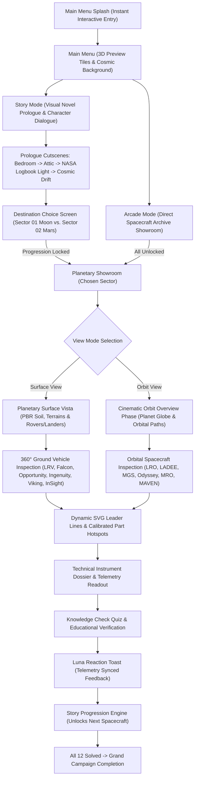

# "Abandoned But Not Forgotten" — Project Documentation & Architectural Reference

**NASA Space Apps Hackathon Web Application**  
*An interactive narrative and 3D exploration experience documenting historic spacecraft abandoned across the solar system.*

---

## 1. Executive Summary & Tech Stack

"Abandoned But Not Forgotten" is a high-fidelity web application that honors human robotic pioneers left behind across the Moon and Mars. Combining visual-novel storytelling with an interactive Three.js 3D planetary and orbital showroom, the application allows users to explore 12 historic spacecraft across ground-level landscapes and circumplanetary orbits.

| Category | Technology | Purpose |
| :--- | :--- | :--- |
| **Framework & UI** | React 18, Vite 6 | Component lifecycle, route/view lazy code splitting (`React.lazy`), fast HMR bundling |
| **3D Graphics Engine** | Three.js (`three@0.187.0`) | Surface terrains, 3D planetary globes, orbital mechanics layer (`orbitLayer.js`), responsive camera auto-framing (`cameraAutoFit.js`), PBR materials, and shared preview canvases (`ModelPreviewCanvas`) |
| **Asset Pipeline & Decoders** | Singleton `GLTFLoader`, `DRACOLoader` (`/draco/`), WebP textures | Draco mesh compression, WebP texture compression, deduplicated fetches, streaming progress, and bounded LRU buffer cache (`modelCache.js`) |
| **Audio Engine** | Web Audio API Synthesizer | 100% procedural sound synthesis: cold-gas thrusters, mechanical camera servos, Martian winds, Lunar vacuum hum, and polyphonic space ambient music |
| **Progression Engine** | Custom LocalStorage State Machine | Persistent campaign progression (`abnf_story_progression_v1`), destination lock/unlock, sequential craft discovery, and custom event dispatches |
| **Responsive Viewport** | Dynamic `100dvh` + `--vh` Engine | Viewport engine (`viewport.js`) handling dynamic iOS Safari toolbars, notch safe-areas (`env(safe-area-inset-*)`), and mobile collapsible bottom sheets |
| **Design Language** | Vanilla CSS + Lucide React | Unified HUD template: rounded black cards (`rgba(0, 0, 0, 0.95)`), 1px solid white borders, high-contrast typography (white text, bold keywords, zero multi-color clutter), and authentic NASA styling |
| **Localization** | Custom Multilingual Dictionary | Bilingual English and Arabic (`en`, `ar`) with logical CSS properties (`padding-inline`, `margin-inline`) ensuring seamless RTL layout stabilization |

---

## 2. Complete Architecture & Feature Catalog



---

## 3. Narrative Story Mode & Character Systems

### 3.1 Visual Novel Story Mode Rebuild (`src/components/StoryGame.jsx`, `story.css`)
- **Full-Screen Immersive Canvas**: Replaced legacy 16:9 framed stages with borderless `100vw x 100dvh` cinematic background art (`object-fit: cover`, `object-position: center`) featuring Ken Burns subtle ambient zoom, cross-fades between shots, and soft vignetting.
- **Character Cut-out (Luna)**:
  - Standing character cut-out positioned bottom-left at 75–85vh height with subtle idle breathing animation and entry slide/fade.
  - Dynamically switches expressions (`neutral`, `thinking`, `happy`, `surprised`) synchronized with story dialogue.
- **Grandpa's NASA Logbook Mode**:
  - When the Mission Logbook speaks, Luna dims subtly while a glowing vintage NASA Logbook illustration (`nasa_book_open.webp`) materializes opposite her on the right side of the screen with a warm amber ambient glow.
- **HUD Dialogue Box Template**:
  - Centered at the bottom (85–92% viewport width, max 960px).
  - Dark semi-transparent card (`rgba(0, 0, 0, 0.95)` with 1px light border, `border-radius: 12px`, and backdrop blur).
  - Speaker identification banner sits directly inside the top header of the card in high-contrast cyan/amber.
  - Body text uses clean typography with `**bold**` keyword highlights, strictly eliminating distracting multi-color spans.
  - Keyboard/touch navigation: `Space`, `Enter`, or screen tap advances lines; includes "LOG X / Y" progress counter and instant skip button.
- **Cinematic 5-Shot Sequence**:
  1. *Shot 1*: Luna at her window gazing at the night sky, pondering forgotten robots.
  2. *Shot 2*: Discovering her grandfather's vintage NASA mission logbook in the attic.
  3. *Shot 3*: Opening the logbook as warm golden light erupts: *"To remember is to bring them home."*
  4. *Shot 4*: Holographic celestial projections and orbital trajectories fill the room.
  5. *Shot 5*: Floating above Earth in cosmic space, unlocking Scene 3 (The Destination Choice).

### 3.2 Luna Reaction System (`src/components/LunaReactionToast.jsx`)
- Non-blocking, visual-novel styled toast dialog appearing after successfully passing any spacecraft knowledge quiz in Story Mode.
- Features Luna's circular avatar, telemetry sync icon, and localized reassuring commentary praising the restoration of historic telemetry records.
- Automatically dismisses after 5 seconds or via tap/click.

### 3.3 Campaign Progression Engine (`src/utils/storyProgression.js`)
- **Persistent Key**: `abnf_story_progression_v1` in `localStorage`.
- **Linear Moon-First Progression**: In Story Mode, the Moon (Sector 01) is the mandatory starting sector. Mars (Sector 02) is strictly locked with a warning badge until the player completes all spacecraft quizzes across the Moon (`completedAreas.moon === true`). Once the Moon is conquered, Sector 02 (Mars) unlocks automatically.
- **Sequential Spacecraft Unlocks**: Within a sector, only the first craft is initially unlocked. Subsequent crafts unlock sequentially as the player passes each craft's interactive knowledge quiz.
- **Event Bus Integration**: Dispatches `window.dispatchEvent(new CustomEvent('storyProgressionUpdated'))` and `gameAudioCue` events on every progression change, allowing reactive UI updates across all components.
- **Arcade Mode**: Accessible from the Main Menu, providing unrestricted free-flight access to all 12 spacecraft without progression gating.

---

## 4. Planetary Showroom & 3D Environments

The showroom supports two distinct planetary theaters: **The Moon** and **Mars**. Each theater features both ground-level surface exploration and true 3D circumplanetary orbital flight.

### 4.1 The Complete 12-Spacecraft Fleet

| Destination | Realm | Spacecraft | Role / Historic Context | 3D Model |
| :--- | :--- | :--- | :--- | :--- |
| **The Moon** | Surface | **Apollo Lunar Roving Vehicle (LRV)** | Humanity's first electric rover; parked at Hadley Rille | `lunar_rover-opt.glb` |
| | Surface | **Apollo 15 Lunar Module (Falcon)** | Crewed lander descent stage serving as launch platform | `lunar_module-opt.glb` |
| | Orbit | **Lunar Reconnaissance Orbiter (LRO)** | Polar mapping orbiter mapping lunar topography in sub-meter detail | `lro-opt.glb` |
| | Orbit | **LADEE Atmosphere Explorer** | Tenuous exosphere & dust probe; demonstrated LLCD laser comms | `ladee-opt.glb` |
| **Mars** | Surface | **MER-B Opportunity Rover** | Marathon exploration rover; 5,111 sols in Meridiani Planum | `mer_rover-opt.glb` |
| | Surface | **Ingenuity Mars Helicopter** | First powered aerial flight on another world; 72 flights | `ingenuity-opt.glb` |
| | Surface | **Viking 1 Lander** | First long-duration robotic surface science station on Mars | `viking_lander-opt.glb` |
| | Surface | **InSight Mars Lander** | Geophysical station recording Martian seismic pulses (marsquakes) | `insight-opt.glb` |
| | Orbit | **Mars Global Surveyor (MGS)** | Global cartographer that discovered hematite water deposits | `mgs-opt.glb` |
| | Orbit | **2001 Mars Odyssey** | Longest continuously operating spacecraft at Mars; mapped water ice | `odyssey-opt.glb` |
| | Orbit | **Mars Reconnaissance Orbiter (MRO)** | HiRISE camera providing 30cm/px imaging and UHF relay | `mro-opt.glb` |
| | Orbit | **MAVEN Atmospheric Observatory** | Investigating how solar winds stripped away the Martian atmosphere | `maven-opt.glb` |

### 4.2 Surface View Environments
- **Moon Surface (`moon_surface-opt.glb`)**:
  - Welded single-mesh scene elevation offset to `y = 239.28`, placing the central crater floor at `y = 0.000`.
  - Camera `far = 8000` preserving 10km lunar mountain horizons without flat planar artifacts.
  - Linear vacuum fog (`THREE.Fog(0x020409, 3500, 7500)`) maintaining crystal-clear vacuum clarity within the crater.
  - Rotating 3D Earthrise (`realistic_earth-opt.glb`) positioned at `[-65, 38, -120]` with cool blue directional earthshine.
  - Directional sun radiance (`#fffaea`, intensity 2.45) with `THREE.PCFShadowMap` and shadow normal bias calibration.
- **Mars Surface (`mud_of_mars-opt.glb`)**:
  - Scaled horizontally to `140.0` (280m span) and vertically to `35.0` (elevation offset `y = 0.319`).
  - Circular perimeter taper smoothly tapering vertices beyond radius 84m down to the ground skirt (`y = -0.21`).
  - Warm directional sun (`#ffc58e`, intensity 2.5) with wide frustum shadow coverage and dusty atmospheric fog (`#240d08`, 35m–175m).
  - Spatial separation of surface fleet: Opportunity at origin `[0, 0, 0]`, Ingenuity at `[-14, 0.02, -7]`, Viking 1 at `[16, -0.08, -8]`, and InSight at `[0, 0, -22]`.

### 4.3 Orbital Mechanics & Orbit Overview Phase (`src/scene/orbitLayer.js`, `cameraAutoFit.js`)
- **Interactive Orbit Layer (`orbitLayer.js`)**:
  - Central 3D planetary globe with PBR surface textures, terminator shadowing, and physical axial spin (`spinSpeed = 0.012–0.014`).
  - Real-time orbital propagation along true 3D elliptical orbits with realistic inclination angles and flight tangents.
  - Martian moons: Phobos and Deimos modeled with elliptical orbits encircling the Red Planet.
  - Glowing HUD orbit trajectories with radial tick markers wrapped directly around the planet sphere.
  - Interactive orbital beacon tags and labels (`LRO`, `LADEE`, `MGS`, `ODY`, `MRO`, `MAVEN`).
- **Cinematic Orbit Overview Phase**:
  - When entering Orbit View (or upon clicking "ORBIT OVERVIEW" in the top HUD), a dedicated overview phase activates.
  - Camera pulls back dynamically to frame the entire planetary globe, all orbital paths, and the natural satellites in a single breathtaking vista.
  - Clicking or scrolling forwards transitions smoothly from the global vantage down to hero inspection framing of the selected orbiter.
- **Camera Auto-Fit Engine (`cameraAutoFit.js`)**:
  - Calculates dynamic camera distance based on the object's 3D bounding sphere and the viewport's limiting field of view (limiting vertical FOV in landscape, horizontal FOV in portrait):
    $$d = \frac{r}{\sin(\min(\theta_v, \theta_h) / 2)} \times \text{margin}$$
  - Ensures orbiters never clip, appear oversized, or get obscured by interface panels.

---

## 5. 3D HUD Pointers & Dynamic Telemetry Leader Lines

Every vehicle part has synchronized SVG leader lines projecting from 3D world space coordinates onto the 2D screen.

### 5.1 Calibrated Part Hotspots Table

| Spacecraft | Hotspot ID | Part Name | World Position `[x, y, z]` | Offset `{x, y}` |
| :--- | :--- | :--- | :--- | :--- |
| **Lunar Rover** | `lrv-tv` | Color TV Camera | `[0.68, 1.15, 0.40]` | `{ x: 80, y: -50 }` |
| | `lrv-hga` | High-Gain Umbrella Dish | `[0.99, 1.55, 0.14]` | `{ x: 85, y: -65 }` |
| | `lrv-wheel` | Woven Wire Wheels | `[0.29, 0.38, 0.75]` | `{ x: -85, y: -35 }` |
| | `lrv-battery`| 36V Dual Ag-Zn Battery | `[0.12, 0.75, 0.35]` | `{ x: 85, y: 40 }` |
| **Apollo Lunar Module** | `lm-descent` | Descent Stage & Engine | `[-18.0, 0.85, 10.0]` | `{ x: -85, y: 40 }` |
| | `lm-footpad` | Landing Gear & Footpad | `[-15.8, 0.35, 12.2]` | `{ x: 85, y: 45 }` |
| | `lm-mesa` | Modular Equipment Stowage | `[-18.8, 1.65, 8.8]` | `{ x: -85, y: -35 }` |
| | `lm-antenna` | S-Band Steerable Antenna | `[-17.3, 3.85, 11.2]` | `{ x: 85, y: -55 }` |
| **LRO Orbiter** | `lro-hga` | High-Gain Antenna (HGA) | `[16.58, -10.52, 2.95]` | `{ x: 85, y: -45 }` |
| | `lro-cam` | LROC Narrow Angle Camera | `[15.58, -11.12, 2.50]` | `{ x: -85, y: -35 }` |
| | `lro-solar` | Solar Array Wing | `[15.08, -10.92, 3.15]` | `{ x: 85, y: 35 }` |
| **LADEE Orbiter** | `ladee-laser` | LLCD Optical Laser Terminal | `[-15.27, -10.16, 16.03]` | `{ x: 85, y: -40 }` |
| | `ladee-dust` | Lunar Dust Experiment | `[-16.02, -10.76, 15.53]` | `{ x: -85, y: 35 }` |
| | `ladee-cells` | Body Solar Array Panels | `[-16.12, -10.31, 16.18]` | `{ x: -85, y: -30 }` |
| **Opportunity** | `oppy-pancam` | Pancam/Navcam Mast | `[-0.04, 1.55, 0.34]` | `{ x: 80, y: -50 }` |
| | `oppy-solar` | Solar Array Wings | `[0.92, 1.10, -0.29]` | `{ x: 85, y: -25 }` |
| | `oppy-arm` | 5-Joint Arm & RAT | `[-0.04, 0.50, 0.75]` | `{ x: -85, y: 35 }` |
| | `oppy-wheels`| Rocker-Bogie Mobility | `[0.98, 0.35, -0.11]` | `{ x: 85, y: 45 }` |
| **Ingenuity** | `ing-solar` | Top Solar Array | `[-14.00, 0.80, -7.00]` | `{ x: 85, y: -55 }` |
| | `ing-rotor-upper` | Upper Rotor Blade | `[-13.75, 0.66, -6.85]` | `{ x: -85, y: -35 }` |
| | `ing-rotor-lower` | Lower Rotor Blade | `[-14.25, 0.54, -7.15]` | `{ x: 85, y: -20 }` |
| | `ing-camera` | Nav Eye & Horizon Cam | `[-13.95, 0.34, -6.90]` | `{ x: -85, y: 40 }` |
| **Viking 1 Lander** | `viking-hga` | High-Gain S-Band Dish | `[16.05, 1.27, -8.25]` | `{ x: 85, y: -55 }` |
| | `viking-camera`| Surface Facsimile Cameras | `[15.95, 1.17, -7.85]` | `{ x: -85, y: -45 }` |
| | `viking-arm` | Soil Sampler Boom & Scoop| `[16.55, 0.37, -7.65]` | `{ x: 85, y: 35 }` |
| | `viking-rtg` | SNAP-19 RTG Power | `[15.55, 0.67, -8.15]` | `{ x: -85, y: 30 }` |
| **InSight Lander** | `insight-solar` | UltraFlex Solar Array | `[-2.10, 0.85, -22.0]` | `{ x: -85, y: -45 }` |
| | `insight-arm` | Instrument Deployment Arm | `[0.75, 0.65, -21.15]` | `{ x: 85, y: -35 }` |
| | `insight-wts` | Wind & Thermal Shield | `[0.20, 0.78, -22.2]` | `{ x: -85, y: 35 }` |
| | `insight-antenna`| UHF Relay Antenna & Mast | `[-0.05, 1.25, -22.15]` | `{ x: 85, y: 45 }` |
| **Mars Global Surveyor** | `mgs-dish` | 1.5m High-Gain Antenna | `[17.78, 0.64, 2.97]` | `{ x: 85, y: -45 }` |
| | `mgs-camera` | Mars Orbiter Camera (MOC)| `[16.73, -0.06, 2.52]` | `{ x: -85, y: -35 }` |
| | `mgs-solar` | Solar Array & Drag Flaps | `[15.88, 0.24, 2.87]` | `{ x: -85, y: 40 }` |
| **2001 Mars Odyssey** | `ody-boom` | GRS Instrument Boom | `[0.90, 6.88, 18.02]` | `{ x: 85, y: -45 }` |
| | `ody-themis` | THEMIS Thermal Imager | `[-0.30, 6.33, 17.57]` | `{ x: -85, y: -35 }` |
| | `ody-antenna`| High-Gain Parabolic Dish | `[0.35, 7.13, 17.67]` | `{ x: 85, y: 35 }` |
| **MRO Orbiter** | `mro-dish` | 3.0m High-Gain Dish | `[-16.56, 14.71, -3.78]` | `{ x: 85, y: -50 }` |
| | `mro-hirise` | HiRISE Telescope Camera | `[-17.96, 13.66, -4.38]` | `{ x: -85, y: -35 }` |
| | `mro-solar` | UltraFlex Solar Wings | `[-18.86, 14.11, -3.93]` | `{ x: -85, y: 40 }` |
| **MAVEN Orbiter** | `maven-artemis`| SWEA / Magnetometer Boom | `[11.20, -28.9, -63.5]` | `{ x: 85, y: -45 }` |
| | `maven-dish` | 2.0m High-Gain Antenna | `[10.10, -27.8, -61.2]` | `{ x: -85, y: -35 }` |
| | `maven-solar` | Aerodynamic Gulwing Wings | `[11.90, -28.1, -62.4]` | `{ x: 85, y: 40 }` |

### 5.2 Dynamic SVG Leader Line Mechanics
- **Radar Anchor**: Sits directly on the projected 3D coordinates with a glowing dot and pulsing radar beacon.
- **Elbow Leader Path**: Dynamic SVG path connects `(partX, partY)` to an elbow point, extending horizontally into the HUD telemetry card.
- **Frustum Test**: Guarded with `toPoint.dot(camDir) > 0.05` to guarantee zero inverted or back-facing artifacts.

---

## 6. Handheld & Mobile Viewport Engine (`src/utils/viewport.js`)

To solve mobile browser URL bar and bottom toolbar obstruction issues (particularly in iOS Safari portrait), the application features a dedicated viewport and safe-area engine.

### 6.1 Viewport Configuration & Safe Areas
- **Dynamic Viewport Unit**: Replaces all `100vh` styling with `100dvh`. For browsers lacking native `dvh` support, a JS fallback `--vh` property is maintained (`window.innerHeight * 0.01`), updated continuously via `resize`, `orientationchange`, and `visualViewport` events.
- **Safe Area Padding**: Bottom-anchored elements apply `padding-bottom: max(12px, env(safe-area-inset-bottom))`. Header and lateral controls respect `env(safe-area-inset-top)`, `env(safe-area-inset-left)`, and `env(safe-area-inset-right)`.
- **App Shell Constraint**: `html, body, #root` locked at 100% height with `overflow: hidden; overscroll-behavior: none`. Internal scroll regions are explicitly isolated with `overflow-y: auto; overscroll-behavior: contain`.

### 6.2 Mobile Showroom Layout (`max-width: 640px`)
- **Header (~48px single row)**: NASA meatball logo, truncated title with ellipsis, settings button, and menu hamburger. "SURFACE VIEW" / "ORBIT VIEW" toggles are streamlined.
- **Dedicated 3D Viewport Zone (Flex: 1, >= 45% height)**: The WebGL canvas renders exclusively in this zone, preventing the 3D model from being obscured behind UI cards. Left and right navigation arrows are centered on viewport edges as 48px semi-transparent circular buttons.
- **Collapsible Bottom Info Panel (~30% height)**: Displays craft name, subtitle, status chip, and "VIEW DETAILS" button above the safe area. Can be collapsed down to a title bar via chevron.
- **Sliding Details Bottom Sheet**: Opens to `70dvh` with a drag handle and internal tabs (`INFO`, `TASK`, `QUIZ`). Swipe down, backdrop tap, or `Esc` closes the sheet.
- **Prompt Isolation**: Distinct display logic separates desktop keyboard prompts (`Space to pause`, `Esc to close`) from handheld touch hints (`Tap to pause/close`), preventing overlapping text.

---

## 7. Hybrid Soundtracked & Procedural Audio Engine (`src/audio/surfaceAudio.js`)

The application features three dedicated looping soundtracks paired with real-time procedural Web Audio API synthesis for interactive sound effects and planetary environments:

- **Looping Soundtracks**:
  1. **Menu Theme (`/audio/menu_theme.mp3`)**: Seamlessly loops on the initial Title Splash screen ("PRESS ANY KEY OR CLICK TO CONTINUE") and continues uninterrupted through the Main Navigation Menu right behind it.
  2. **Story Narrative Music (`/audio/story_music.mp3`)**: Seamlessly loops during the visual-novel prologue dialogue sequence before choosing the destination, ducking automatically during typewriter speech and stopping cleanly upon reaching the Destination Choice screen.
  3. **Space Ambient Music (`/audio/space_music.mp3`)**: Loops continuously across the entirety of 3D space—covering all Moon surface and orbital missions, all Mars surface and orbital missions, and the complete Arcade Mode showroom.
- **Audio Controls & Synchronization**:
  - All three soundtracks are centrally managed by `SurfaceAudioEngine`, automatically syncing with the Master Volume slider, Music Volume slider, and Mute Audio toggle from the in-game Settings modal.
  - Automatically handles browser autoplay policies by registering one-time unlock handlers on first interaction (`pointerdown`, `keydown`, `touchstart`).
  - Pauses cleanly when browser tabs are hidden (`document.hidden`) and resumes upon return.
- **Procedural Synthesizers & Sound Effects**:
  - `playThruster`: Cold-gas and hydrazine bursts synthesized using filtered white noise buffers routed through resonant bandpass filters with exponential gain envelope decay.
  - `playServo`: Dual-oscillator pitch-gliding frequency sweeps simulating robotic camera servos.
  - `playLock` / `playUnlock`: Two-tone harmonic frequency pings for part inspection lock and release.
  - `startSurfaceAmbience`: Dual pink-noise wind generators for Mars, deep 58Hz vacuum electrical hum for the Moon, layering with `space_music.mp3`.
  - **Interaction Auto-Unlock**: Automatically initializes and resumes the audio context upon the first user interaction (`pointerdown`, `touchstart`, `keydown`).

---

## 8. Credits, 3D Providers & "The End" Screen Sequence

### 8.1 Cinematic "The End" Screen (`TheEndScreen.jsx`)
- **Trigger**: Appears automatically upon completing all 12 spacecraft across the Moon and Mars campaign in Story Mode, or via the `THE END & CREDITS` action in the Campaign Victory modal.
- **Cinematic Presentation**: Displays the grand title `THE END` (Arabic: `النـهـايـة`), project subtitle `ABANDONED BUT NOT FORGOTTEN`, the poetic tribute quote (`"To every machine that reached beyond the dust..."`), and the team signature `BY BEYOND THE DUST`.
- **Immediate Jump to Credits**: Holds gracefully for 3.8 seconds with an active prompt and countdown before automatically jumping right away into the rolling credits, or immediately upon user click / spacebar / enter.

### 8.2 Rolling Credits Modal (`CreditsModal.jsx`)
The rolling credits modal pays tribute to both human creators, open archives, and the robotic pioneers left among the stars:

- **Team Attribution**: Features `<div className="cr-block cr-team team" id="team">` directly preceding the project leader, celebrating the team name: **`Beyond The Dust`**.
- **Cinematic Roll Timing**: Paced at 85 seconds (`animation: creditsRoll 85s linear 0.6s forwards`) for comfortable, reflective reading.
- **Interactive Controls**: `Space` pauses and resumes the roll; `Esc` or clicking/tapping anywhere closes the modal.
- **Dedicated 3D Model Providers Section**:
  - **NASA 3D Resources**: Science Visualization Studio, Jet Propulsion Laboratory (JPL), Ames Research Center, Langley Research Center, and Goddard Space Flight Center.
  - **Sketchfab 3D Community**: Historical spacecraft reconstructions and planetary open-source telemetry models.
- **Soundtrack & Music Attribution**:
  - Original space ambient music, prologue narrative score, and exploration themes sourced from YouTube creators.
- **Complete 12-Spacecraft Roster**: Every spacecraft is listed alongside its mission dates, planetary landing/orbit coordinates, and historical contribution.

---

## 9. 3D Asset Pipeline & Repository Structure

### 9.1 Offline Optimization Pipeline (`scripts/optimize-models.mjs`)
- Executed via `npm run optimize:models` using `@gltf-transform/cli`.
- Untouched raw `.glb` source assets are archived intact in `models/` (never overwritten).
- Optimized runtime derivatives in `public/models/` apply Draco mesh compression (`KHR_draco_mesh_compression`) and WebP textures (`EXT_texture_webp`) while preserving named PBR materials (`'Chassis'`, `'Wheels'`, `'Antenne'`).
- Decoders are served locally from `public/draco/` with Web Worker concurrency control.

### 9.2 File Structure & Asset Inventory

```
NASA hackton/
├── models/                           # Untouched original raw GLB sources & provenance models
├── public/
│   ├── assets/story/                 # Narrative cutscenes & illustrations (shot1-5, nasa_book_open.webp)
│   ├── audio/                        # Looping audio soundtracks
│   │   ├── menu_theme.mp3            # Title splash & main navigation menu theme
│   │   ├── story_music.mp3           # Visual-novel prologue dialogue narrative score
│   │   └── space_music.mp3           # Universal 3D space theme (Moon, Mars, Arcade)
│   ├── draco/                        # Local Three.js glTF Draco WASM/JS decoders
│   ├── manifest.webmanifest          # PWA web application manifest
│   └── models/                       # Draco + WebP optimized runtime *-opt.glb models
│       ├── lunar_rover-opt.glb       # Apollo Lunar Roving Vehicle (2.65 MiB)
│       ├── lunar_module-opt.glb      # Apollo Lunar Module Falcon (558 KiB)
│       ├── lro-opt.glb               # Lunar Reconnaissance Orbiter (279 KiB)
│       ├── ladee-opt.glb             # LADEE Lunar Atmosphere Explorer (227 KiB)
│       ├── mer_rover-opt.glb         # Mars Exploration Rover Opportunity (715 KiB)
│       ├── ingenuity-opt.glb         # Mars Helicopter Ingenuity (344 KiB)
│       ├── viking_lander-opt.glb     # Viking 1 Lander (243 KiB)
│       ├── insight-opt.glb           # InSight Mars Lander (1.28 MiB)
│       ├── mgs-opt.glb               # Mars Global Surveyor (269 KiB)
│       ├── odyssey-opt.glb           # 2001 Mars Odyssey (702 KiB)
│       ├── mro-opt.glb               # Mars Reconnaissance Orbiter (766 KiB)
│       ├── maven-opt.glb             # MAVEN Atmospheric Observatory (475 KiB)
│       ├── moon_surface-opt.glb      # Welded Moon crater terrain (7.37 MiB)
│       ├── mud_of_mars-opt.glb       # Martian mud & rock regolith terrain (537 KiB)
│       ├── realistic_earth-opt.glb   # 3D Earth backdrop globe (1.04 MiB)
│       ├── moon-opt.glb              # Interactive Moon globe (465 KiB)
│       └── mars-opt.glb              # Interactive Mars globe (450 KiB)
├── scripts/
│   ├── optimize-models.mjs           # GLTF-transform Draco + WebP pipeline
│   └── process_character.py          # Character cutout extraction & sprite processor
├── src/
│   ├── audio/
│   │   └── surfaceAudio.js           # Web Audio API procedural synthesis engine
│   ├── components/
│   │   ├── CosmicBackground.jsx      # Starfield + floating crafts host
│   │   ├── CreditsModal.jsx          # Cinematic rolling credits with 3D provider attributions
│   │   ├── FloatingCraftsCanvas.jsx  # Staggered lazy 3D menu craft flybys
│   │   ├── LunaReactionToast.jsx     # Visual novel feedback toast upon quiz completion
│   │   ├── MainMenu.jsx              # Instant title splash & mode selection
│   │   ├── MissionBriefingDialog.jsx # Mission Control typewriter briefing dialog
│   │   ├── ModelPreviewCanvas.jsx    # Shared Three.js preview canvas component
│   │   ├── MoreEquipmentModal.jsx    # 2D archive modal (ALSEP, Pathfinder, Deep Space)
│   │   ├── PlanetaryShowroom.jsx     # Unified surface & orbit showroom orchestrator
│   │   ├── SettingsModal.jsx         # Audio, Graphics Quality & language settings
│   │   ├── ShowroomStoryPanel.jsx    # Collapsible story sections, quiz & heritage HUD
│   │   ├── SourcesModal.jsx          # Verification & primary source index modal
│   │   ├── StarfieldCanvas.jsx       # Preset-scaled 2D starfield canvas
│   │   ├── StatusBadge.jsx           # Reusable HUD craft status badge + date chip
│   │   ├── StoryGame.jsx             # Visual novel prologue & destination choice flow
│   │   ├── TheEndScreen.jsx          # Cinematic "The End" sequence jumping to credits
│   │   └── TypewriterText.jsx        # Smooth typewriter dialogue renderer
│   ├── constants/
│   │   ├── settings.js               # Settings defaults & graphics quality profiles
│   │   └── translations.js           # Complete bilingual {en, ar} dictionary
│   ├── data/
│   │   └── craftStories.js           # Archival stories, technical dossiers & quizzes
│   ├── scene/
│   │   ├── cameraAutoFit.js          # Responsive bounding-sphere camera framing engine
│   │   └── orbitLayer.js             # Three.js circumplanetary orbital simulation
│   ├── styles/
│   │   ├── menu.css                  # Main menu, HUD tokens, splash & modal styles
│   │   ├── spacecraft.css            # Showroom, dossier, bottom sheet & orbit HUD styles
│   │   └── story.css                 # Visual novel cutscenes, dialogue box & Luna styles
│   ├── utils/
│   │   ├── modelCache.js             # Singleton GLTF/DRACO loader, LRU buffer cache
│   │   ├── storyProgression.js       # Persistent progression engine & custom event bus
│   │   └── viewport.js               # Viewport engine, iOS Safari safe area & haptics
│   ├── App.jsx                       # Top-level route & modal orchestration
│   └── main.jsx                      # React 18 root mount
├── index.html                        # Viewport-fit meta & PWA headers
├── package.json
└── vite.config.js                    # Vite 6 config with vendor manualChunks splitting
```

---

## 10. Operational Verification & Build

- **Development Server**: Run `npm run dev` to launch Vite on `http://localhost:3000/`.
- **Production Build**: Run `npm run build` to verify clean chunk compilation and zero syntax errors.
- **Model Optimization**: Run `npm run optimize:models` whenever new 3D assets are introduced.
- **Browser Compatibility**: Validated on Google Chrome, Mozilla Firefox, Apple Safari (desktop & iOS portrait/landscape), and Android Chromium.
