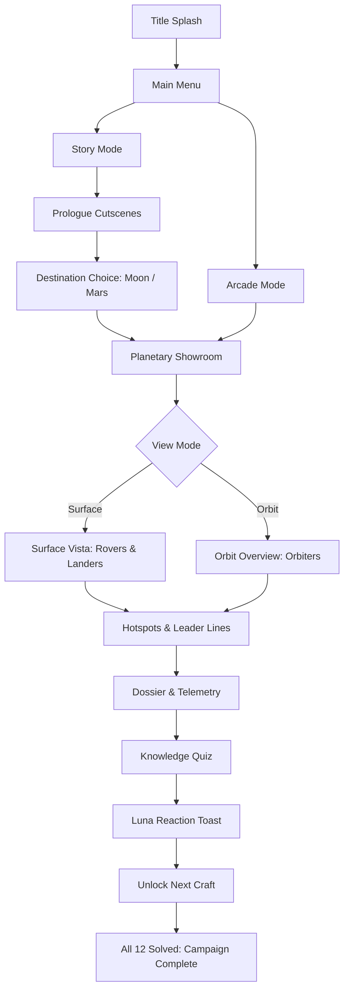

<div align="center">

# 🛰️ Abandoned But Not Forgotten

**An interactive narrative and 3D exploration experience honoring the historic spacecraft left behind on the Moon and Mars.**

*Built for the NASA Space Apps Hackathon*


</div>

---

## 📖 About

**Abandoned But Not Forgotten** combines visual-novel storytelling with an interactive Three.js showroom. Players follow **Luna**, a girl who discovers her grandfather's old NASA mission logbook, and use it to revisit **12 historic robotic spacecraft** across lunar and Martian surfaces and orbits.

> *"To remember is to bring them home."*

Inspect each craft in 3D, explore calibrated part hotspots with live telemetry leader lines, read technical dossiers, and pass knowledge-check quizzes to unlock the next craft.

---

## ✨ Features

- 🎭 **Visual-novel Story Mode**: a fully immersive 5-shot cinematic prologue with an animated character cut-out, a glowing NASA logbook, and a HUD-style dialogue box.
- 🚀 **12-spacecraft fleet**: ground vehicles and orbiters across the Moon and Mars, each with a 3D model, dossier, and quiz.
- 🌍 **Surface View**: PBR terrains for the lunar crater and Martian regolith, with a rotating Earthrise on the Moon and dusty atmospheric fog on Mars.
- 🛸 **Orbit View**: true 3D elliptical orbits, Phobos and Deimos, and a cinematic *Orbit Overview* camera pull-back.
- 🎯 **Dynamic HUD hotspots**: SVG leader lines projected from 3D world coordinates onto calibrated part pointers, with frustum culling to avoid back-facing artifacts.
- 🔊 **Hybrid audio engine**: three looping soundtracks plus 100% procedural Web Audio effects (thrusters, servos, Martian wind, lunar vacuum hum).
- 💾 **Persistent campaign progression**: Moon-first linear campaign with sequential unlocks, saved in `localStorage`.
- 🕹️ **Arcade Mode**: unrestricted access to all 12 spacecraft.
- 📱 **Mobile-first viewport engine**: `100dvh` and `--vh` fallback, iOS Safari safe-area handling, collapsible bottom sheets.
- 🌐 **Bilingual**: English and Arabic with full RTL layout support via CSS logical properties.
- ⚡ **Optimized assets**: Draco-compressed meshes, WebP textures, a deduplicated singleton loader, and an LRU buffer cache.

---

## 🛰️ The Fleet

| Destination | Realm | Spacecraft | Highlight |
| :--- | :--- | :--- | :--- |
| 🌕 **Moon** | Surface | Apollo Lunar Roving Vehicle (LRV) | First electric rover, parked at Hadley Rille |
| | Surface | Apollo 15 Lunar Module (Falcon) | Descent stage serving as launch platform |
| | Orbit | Lunar Reconnaissance Orbiter (LRO) | Sub-meter lunar topography mapping |
| | Orbit | LADEE | Exosphere and dust probe; LLCD laser comms demo |
| 🔴 **Mars** | Surface | MER-B Opportunity | 5,111 sols in Meridiani Planum |
| | Surface | Ingenuity Helicopter | First powered flight on another world (72 flights) |
| | Surface | Viking 1 Lander | First long-duration robotic surface science station |
| | Surface | InSight Lander | Recorded Martian seismic activity (marsquakes) |
| | Orbit | Mars Global Surveyor (MGS) | Global cartographer; found hematite deposits |
| | Orbit | 2001 Mars Odyssey | Longest continuously operating spacecraft at Mars |
| | Orbit | Mars Reconnaissance Orbiter (MRO) | HiRISE 30 cm/px imaging and UHF relay |
| | Orbit | MAVEN | Studies how solar wind stripped the Martian atmosphere |

---

## 🗺️ Application Flow



---

## 🧰 Tech Stack

| Category | Technology |
| :--- | :--- |
| Framework & UI | React 18, Vite 6 (`React.lazy` code splitting) |
| 3D Engine | Three.js `0.187.0` |
| Asset Pipeline | `GLTFLoader`, `DRACOLoader`, WebP textures, `@gltf-transform/cli` |
| Audio | Web Audio API (procedural synthesis) + MP3 soundtracks |
| State | Custom `localStorage` state machine and window event bus |
| Styling | Vanilla CSS, Lucide React icons |
| Localization | Custom `{ en, ar }` dictionary with RTL support |

---

## 🚀 Getting Started

### Prerequisites

- [Node.js](https://nodejs.org/) (LTS recommended)
- npm

### Installation

```bash
# Clone the repository
git clone https://github.com/<your-username>/<your-repo>.git
cd <your-repo>

# Install dependencies
npm install
```

### Run

```bash
# Start the dev server (http://localhost:3000)
npm run dev

# Create a production build
npm run build
```

### Optimize 3D models

Run this whenever you add new raw `.glb` files to `models/`:

```bash
npm run optimize:models
```

This applies Draco mesh compression and WebP textures, writing `*-opt.glb` files to `public/models/` while leaving the originals untouched.

---

## 🎮 Controls

| Action | Desktop | Mobile |
| :--- | :--- | :--- |
| Advance dialogue | `Space` / `Enter` / click | Tap |
| Pause / resume inspection or credits | `Space` | Tap |
| Close modal / sheet | `Esc` | Swipe down / tap backdrop |
| Orbit Overview | "ORBIT OVERVIEW" HUD button | Same |

---

## 🧠 Technical Highlights

<details>
<summary><b>Campaign progression</b></summary>

- Persisted under `abnf_story_progression_v1` in `localStorage`.
- The Moon is the mandatory first sector. Mars stays locked until all lunar quizzes are passed.
- Within a sector, crafts unlock one at a time as quizzes are passed.
- Every change dispatches `storyProgressionUpdated` and `gameAudioCue` events for reactive UI.

</details>

<details>
<summary><b>Responsive camera auto-fit</b></summary>

`cameraAutoFit.js` computes the camera distance from the object's bounding sphere and the viewport's limiting field of view (vertical in landscape, horizontal in portrait):

```
d = r / sin( min(θv, θh) / 2 ) × margin
```

This keeps orbiters from clipping or hiding behind interface panels.

</details>

<details>
<summary><b>Leader line projection</b></summary>

Each hotspot's 3D world position is projected to screen space and joined to its HUD card by an elbow SVG path. A frustum test (`toPoint.dot(camDir) > 0.05`) prevents inverted or back-facing lines.

</details>

<details>
<summary><b>Audio engine</b></summary>

`SurfaceAudioEngine` manages three soundtracks (menu, story, space) and syncs with the Master Volume, Music Volume, and Mute controls. It handles autoplay policies with one-time unlock handlers and pauses when the tab is hidden. Procedural effects include `playThruster`, `playServo`, `playLock`/`playUnlock`, and `startSurfaceAmbience`.

</details>

<details>
<summary><b>Mobile viewport engine</b></summary>

`viewport.js` replaces `100vh` with `100dvh` (plus a `--vh` fallback), applies `env(safe-area-inset-*)` padding, locks the app shell against overscroll, and provides a mobile layout with a dedicated 3D viewport, a collapsible info panel, and a `70dvh` details bottom sheet.

</details>

---

## 📁 Project Structure

```
├── models/                  # Untouched raw GLB sources
├── public/
│   ├── assets/story/        # Cutscene art & NASA logbook illustration
│   ├── audio/               # menu_theme, story_music, space_music (.mp3)
│   ├── draco/               # Local Draco decoders
│   ├── models/              # Optimized *-opt.glb runtime models
│   └── manifest.webmanifest # PWA manifest
├── scripts/
│   ├── optimize-models.mjs  # Draco + WebP pipeline
│   └── process_character.py # Character cut-out processor
├── src/
│   ├── audio/               # surfaceAudio.js
│   ├── components/          # StoryGame, PlanetaryShowroom, MainMenu, modals, ...
│   ├── constants/           # settings.js, translations.js
│   ├── data/                # craftStories.js (dossiers & quizzes)
│   ├── scene/               # orbitLayer.js, cameraAutoFit.js
│   ├── styles/              # menu.css, spacecraft.css, story.css
│   ├── utils/               # modelCache.js, storyProgression.js, viewport.js
│   ├── App.jsx
│   └── main.jsx
├── index.html
├── package.json
└── vite.config.js
```

---

## 🌐 Browser Support

Validated on Google Chrome, Mozilla Firefox, Apple Safari (desktop and iOS, portrait and landscape), and Android Chromium.

---

## 🙏 Credits & Acknowledgements

- **NASA 3D Resources**: Science Visualization Studio, Jet Propulsion Laboratory (JPL), Ames Research Center, Langley Research Center, and Goddard Space Flight Center.
- **Sketchfab community**: historical spacecraft reconstructions and planetary models.
- **Music**: space ambient, prologue score, and exploration themes sourced from YouTube creators.

Please review the licenses of all third-party 3D models and audio before redistributing or deploying commercially.

---

## 📄 License

Add your license here (for example, MIT) and include a `LICENSE` file in the repository root.

---

<div align="center">

*Dedicated to the robotic pioneers still resting among the stars.* 🌙🔴

</div>
